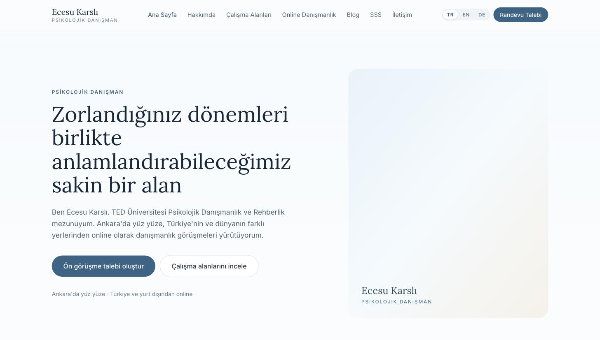
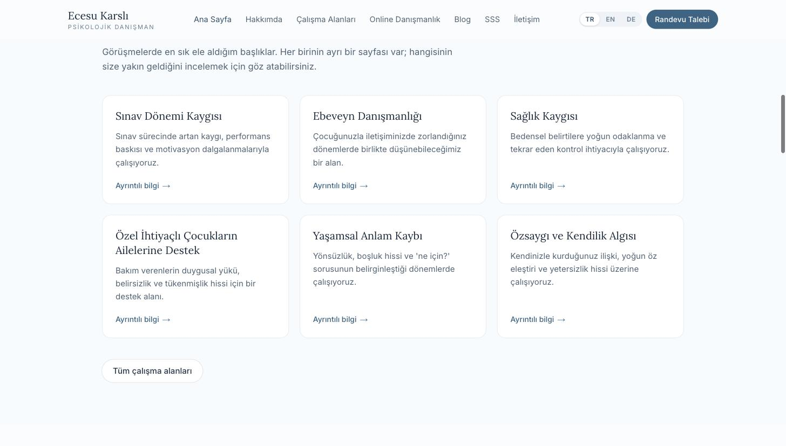
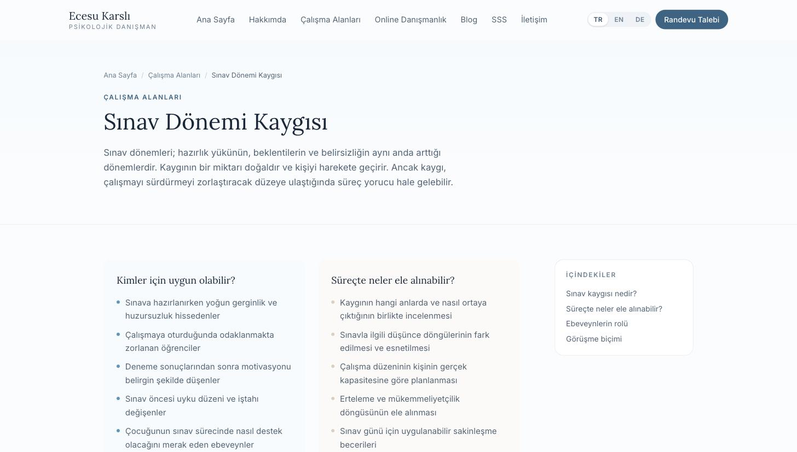
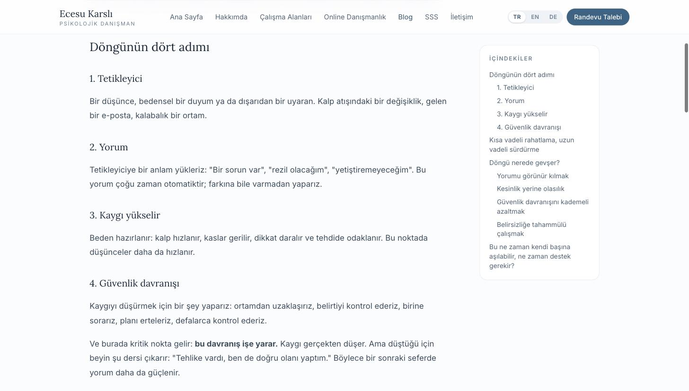
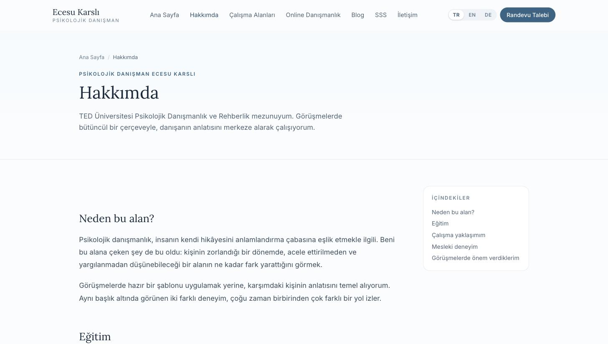
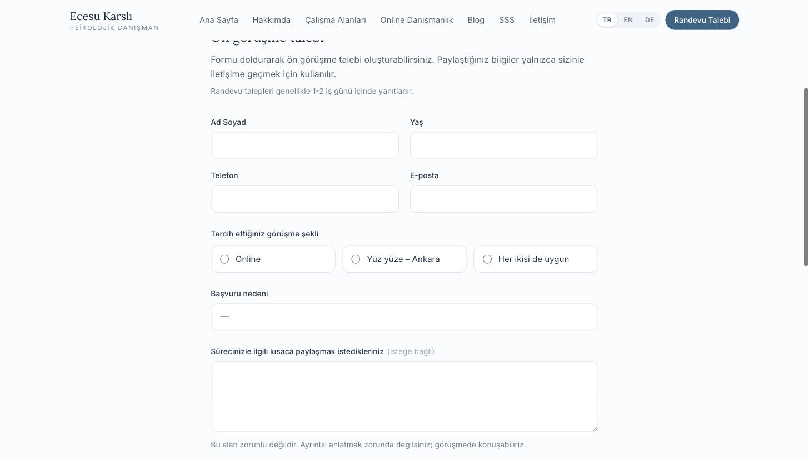
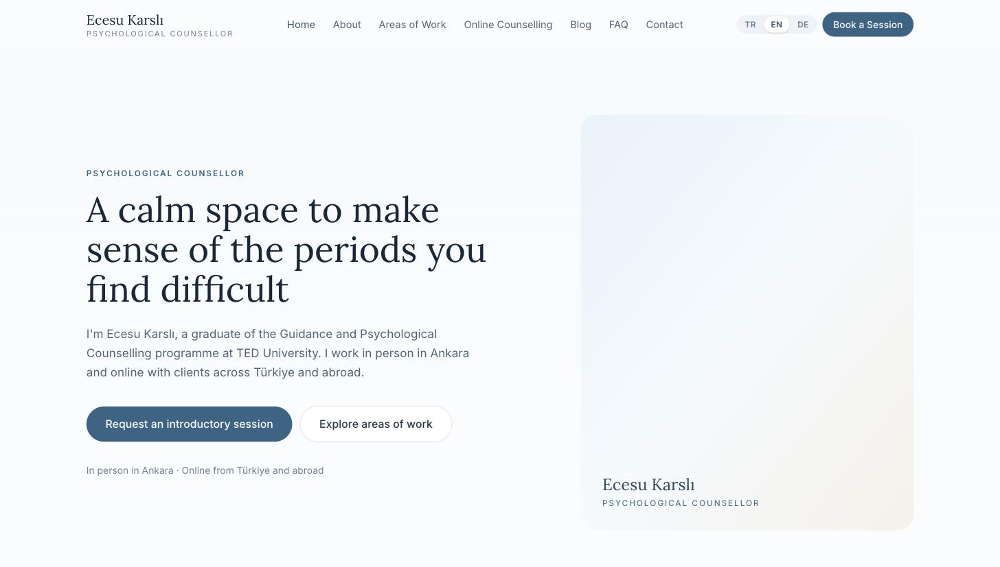
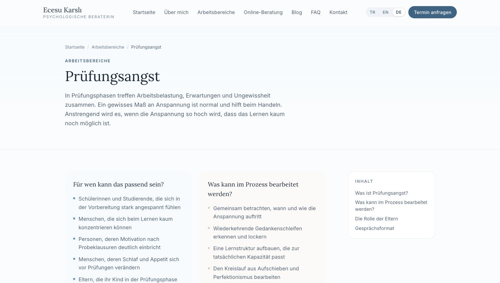

# Psikolojik Danışman Ecesu Karslı — Web Sitesi

Üç dilli (Türkçe / İngilizce / Almanca), içerikleri yönetim panelinden
düzenlenebilen, SEO ve yapay zekâ tabanlı arama motorları için yapılandırılmış
kurumsal tanıtım ve blog sitesi.

**Teknolojiler:** Next.js 16 (App Router) · TypeScript · Tailwind CSS 4 ·
Supabase (PostgreSQL + Auth + Storage) · Vercel

---

## Ekran görüntüleri

> Aşağıdaki kareler, `npm run seed` çalıştırılmadan (yani kod içindeki başlangıç
> içerikleriyle) alınmıştır. Hero bölümündeki fotoğraf alanı, gerçek bir görsel
> yüklenmediği için yer tutucu panel olarak görünür; sahte fotoğraf kullanılmaz.

### Ana sayfa





### Çalışma alanı detay sayfası

Her çalışma alanının kendi SEO landing page'i var: kimler için uygun olabileceği,
süreçte nelerin ele alınabileceği ve Markdown gövdeden otomatik üretilen
içindekiler listesi.



### Blog yazısı

Okunma süresi, breadcrumb, otomatik içindekiler, ilgili yazılar ve paylaşım alanı.



### Hakkımda



### Randevu / ön görüşme formu

Veri minimizasyonu gözetilerek tasarlandı; serbest metin alanı zorunlu değil,
açık rıza kutusu ayrı sunuluyor.



### Çok dillilik

Aynı sayfaların İngilizce ve Almanca sürümleri — arayüz, içerik ve URL'ler
tamamen yerelleştirilmiş.





---

## İçindekiler

1. [Ekran görüntüleri](#ekran-görüntüleri)
2. [Hızlı başlangıç](#hızlı-başlangıç)
3. [Ortam değişkenleri](#ortam-değişkenleri)
4. [Supabase kurulumu](#supabase-kurulumu)
5. [Veritabanı kurulumu (migration)](#veritabanı-kurulumu-migration)
6. [Storage kurulumu](#storage-kurulumu)
7. [Başlangıç içeriklerini yükleme (seed)](#başlangıç-i̇çeriklerini-yükleme-seed)
8. [Admin kullanıcı oluşturma](#admin-kullanıcı-oluşturma)
9. [Geliştirme ortamı](#geliştirme-ortamı)
10. [Production build](#production-build)
11. [Vercel'e deploy](#vercele-deploy)
12. [Proje yapısı](#proje-yapısı)
13. [Çok dillilik nasıl çalışıyor?](#çok-dillilik-nasıl-çalışıyor)
14. [İçerik yönetimi](#i̇çerik-yönetimi)
15. [SEO ve GEO](#seo-ve-geo)
16. [Güvenlik ve KVKK notları](#güvenlik-ve-kvkk-notları)
17. [Erişilebilirlik](#erişilebilirlik)
18. [Yayına almadan önce kontrol listesi](#yayına-almadan-önce-kontrol-listesi)

---

## Hızlı başlangıç

```bash
npm install
cp .env.example .env.local     # değerleri doldurun
npm run dev                    # http://localhost:3000
```

> Supabase yapılandırılmadan da site çalışır: bu durumda `src/content/` altındaki
> başlangıç içerikleri gösterilir. Yönetim paneli ve randevu formu ise Supabase
> bağlantısı gerektirir.

Gereksinimler: **Node.js 20 veya üzeri** (18.18+ çalışır, 20 LTS önerilir).

---

## Ortam değişkenleri

`.env.example` dosyasını `.env.local` olarak kopyalayıp doldurun.

| Değişken | Zorunlu | Açıklama |
| --- | --- | --- |
| `NEXT_PUBLIC_SITE_URL` | evet | Sitenin tam adresi (sonunda `/` olmadan). Canonical, hreflang, sitemap ve OG etiketleri buna göre üretilir. |
| `NEXT_PUBLIC_SUPABASE_URL` | evet | Supabase proje URL'i |
| `NEXT_PUBLIC_SUPABASE_ANON_KEY` | evet | Public anahtar. RLS ile korunur. |
| `SUPABASE_SERVICE_ROLE_KEY` | evet | **Gizli.** RLS'i atlar; yalnızca sunucu tarafında (randevu kaydı, seed, admin oluşturma) kullanılır. |
| `SUPABASE_STORAGE_BUCKET` | hayır | Varsayılan: `media` |
| `NEXT_PUBLIC_ANALYTICS_ENABLED` | hayır | `true` yapılmadıkça hiçbir ölçümleme scripti yüklenmez. |
| `NEXT_PUBLIC_ANALYTICS_DOMAIN` / `NEXT_PUBLIC_ANALYTICS_SRC` | hayır | Plausible benzeri çerezsiz bir ölçümleme kullanılacaksa. |

> `NEXT_PUBLIC_SITE_URL` build sırasında sabitlenir. Domain değişirse yeniden
> deploy etmeniz gerekir.

---

## Supabase kurulumu

1. [supabase.com](https://supabase.com) üzerinde yeni bir proje oluşturun.
   Bölge olarak Frankfurt (`eu-central-1`) gibi Türkiye'ye yakın bir seçenek
   gecikmeyi azaltır.
2. **Project Settings → API** ekranından şu değerleri `.env.local` dosyasına kopyalayın:
   - `Project URL` → `NEXT_PUBLIC_SUPABASE_URL`
   - `anon public` → `NEXT_PUBLIC_SUPABASE_ANON_KEY`
   - `service_role` → `SUPABASE_SERVICE_ROLE_KEY`
3. **Authentication → Providers** bölümünde yalnızca *Email* açık kalsın.
4. **Authentication → Sign In / Providers → Email** altında
   **"Allow new users to sign up"** seçeneğini **kapatın**. Sitede kayıt formu
   yoktur; admin kullanıcı yalnızca script ile oluşturulur.

---

## Veritabanı kurulumu (migration)

Supabase panelinde **SQL Editor**'ü açın ve dosyaları **sırasıyla** çalıştırın:

```
database/migrations/0001_schema.sql    → tablolar, indeksler, tetikleyiciler
database/migrations/0002_rls.sql       → Row Level Security politikaları
database/migrations/0003_storage.sql   → görsel bucket'ı ve politikaları
```

Dosyalar tekrar çalıştırılabilir (`if not exists` / `drop policy if exists`).

**Şema özeti**

| Tablo | Amaç |
| --- | --- |
| `admins` | Yönetim paneline erişebilen kullanıcılar |
| `site_settings` | Ana sayfa metinleri, iletişim bilgileri, görsel adresleri (`key` + `locale`) |
| `pages` | Hakkımda, online danışmanlık, Ankara ve yasal metinler |
| `services` | Çalışma alanları ve SEO detay sayfaları |
| `faqs` | Sık sorulan sorular |
| `blog_categories` | Blog kategorileri |
| `blog_posts` | Blog yazıları (taslak / yayında) |
| `appointment_requests` | Randevu / ön görüşme talepleri |
| `media` | Yüklenen görsellerin kaydı ve alternatif metinleri |

İçerik tabloları `locale` + `translation_key` ikilisiyle çalışır: aynı içeriğin
farklı dillerdeki karşılıkları ortak `translation_key` ile eşleşir, `slug`'lar
dile göre farklı olabilir.

---

## Storage kurulumu

`0003_storage.sql` çalıştırıldığında `media` adında **public** bir bucket
oluşturulur:

- En büyük dosya boyutu: **3 MB**
- İzin verilen türler: JPEG, PNG, WebP, AVIF
- Okuma herkese açık, yazma yalnızca admin kullanıcıya açıktır.

Yüklenen her görsel için yönetim panelinde **alternatif metin zorunludur**.

---

## Başlangıç içeriklerini yükleme (seed)

`src/content/{tr,en,de}/` altındaki metinleri veritabanına yazar:

```bash
npm run seed
```

- `locale` + `translation_key` üzerinden **upsert** yapar; komut birden fazla kez
  çalıştırılabilir.
- Panelden yapılmış değişikliklerin üzerine yazar; ilk kurulumdan sonra
  yalnızca bilinçli olarak çalıştırın.
- Telefon, e-posta ve sosyal medya alanları bilerek **boş** bırakılmıştır.
  Gerçek bilgiler panelden girilene kadar sitede gösterilmez.

---

## Admin kullanıcı oluşturma

```bash
npm run create-admin -- eposta@ornek.com "GucluBirParola123" "Ecesu Karslı"
```

Komut, Supabase Auth kullanıcısını oluşturur (e-posta doğrulanmış olarak) ve
`admins` tablosuna ekler. Kullanıcı zaten varsa yalnızca yetkilendirmeyi ekler.

Giriş: **`/admin/giris`**

Panelde kayıt (sign-up) ekranı yoktur; yeni yönetici eklemenin tek yolu bu
komuttur.

---

## Geliştirme ortamı

```bash
npm run dev         # geliştirme sunucusu
npm run typecheck   # TypeScript kontrolü
npm run lint        # ESLint
npm run build       # production build
npm start           # build çıktısını çalıştır
```

---

## Production build

```bash
npm run build
npm start
```

Public sayfalar ISR ile üretilir (ana sayfa ve içerik sayfaları 10 dk, blog
5 dk). Panelden yapılan her kayıt `revalidatePath` ile siteyi tazeler, bu yüzden
değişiklikler beklemeden yayına yansır.

---

## Vercel'e deploy

1. Depoyu GitHub'a gönderin, Vercel'de **New Project** ile içe aktarın.
2. Framework otomatik olarak Next.js algılanır; ek yapılandırma gerekmez.
3. **Settings → Environment Variables** altına `.env.local` içindeki tüm
   değişkenleri ekleyin. `NEXT_PUBLIC_SITE_URL` production domain'i olmalıdır
   (ör. `https://ecesukarsli.com`).
4. `SUPABASE_SERVICE_ROLE_KEY` yalnızca **Production/Preview** ortamına eklenmeli,
   asla repoya girmemelidir.
5. Deploy edin. Ardından Google Search Console'a
   `https://alanadi.com/sitemap.xml` adresini gönderin.

Domain bağladıktan sonra `NEXT_PUBLIC_SITE_URL` değerini güncelleyip **yeniden
deploy** etmeyi unutmayın; canonical ve hreflang adresleri bu değeri kullanır.

---

## Proje yapısı

```
database/migrations/     SQL şema, RLS ve storage dosyaları
scripts/                 seed ve admin oluşturma script'leri
src/
  app/
    (site)/[locale]/     Genel siteye ait tüm sayfalar (kendi root layout'u)
    (admin)/admin/       Yönetim paneli (ayrı root layout)
    api/language/        Dil değiştirme yönlendirmesi
    sitemap.ts robots.ts
  components/
    ui/                  Button, Container, Field, Prose, SectionTitle…
    layout/              Header, Footer, LanguageSwitcher, SkipLink
    shared/              ServiceCard, BlogCard, FaqAccordion, CTA, Breadcrumb…
  features/
    appointments/        Randevu formu, şema ve server action
    admin/               Panel formları, action'lar, yetkilendirme
  content/{tr,en,de}/    Başlangıç içerikleri (seed + yedek kaynak)
  i18n/                  Dil listesi, rota haritası, arayüz sözlükleri
  lib/
    data/                Supabase okuma katmanı (+ içerik yedeği)
    supabase/            İstemciler (public / server / service role)
    seo.ts jsonld.ts     Metadata ve structured data
  proxy.ts               Dil yönlendirmesi + admin oturum koruması
```

### `src/content` neden var?

Bu klasör **çalışma zamanı içerik kaynağı değildir**. İki işi vardır:

1. `npm run seed` komutunun tek kaynağı olur (3 dilde SQL yazmak yerine).
2. Supabase henüz kurulmamışsa ya da erişilemiyorsa site boş görünmesin diye
   yedek içerik sağlar.

Seed çalıştırıldıktan sonra site tüm içeriği veritabanından okur; panelden
yapılan değişiklikler bu dosyalara dokunmaz.

---

## Çok dillilik nasıl çalışıyor?

- Diller: `tr` (varsayılan), `en`, `de`. Tüm adresler dil önekiyle başlar.
- `/` adresi, tarayıcı diline ve `NEXT_LOCALE` çerezine bakarak yönlendirilir.
- Yollar her dilde ayrıdır ve `src/i18n/routes.ts` içinde tanımlıdır:

| Sayfa | TR | EN | DE |
| --- | --- | --- | --- |
| Hakkımda | `/tr/hakkimda` | `/en/about` | `/de/ueber-mich` |
| Çalışma alanları | `/tr/calisma-alanlari` | `/en/services` | `/de/leistungen` |
| Online danışmanlık | `/tr/online-danismanlik` | `/en/online-counselling` | `/de/online-beratung` |
| Ankara | `/tr/ankara-psikolojik-danismanlik` | `/en/counselling-in-ankara` | `/de/beratung-in-ankara` |
| SSS | `/tr/sss` | `/en/faq` | `/de/haeufige-fragen` |
| Randevu | `/tr/randevu` | `/en/appointment` | `/de/termin` |

- `src/proxy.ts`, görünen adresi uygulama içindeki ortak rotaya çevirir
  (rewrite). Yanlış dildeki bir yolla gelinirse 308 ile doğru adrese yönlendirir.
- Dil değiştirme bağlantıları `/api/language` üzerinden çalışır; böylece blog ve
  çalışma alanı sayfalarında slug'lar da doğru dile çevrilir.
- Her sayfa `hreflang` alternatiflerini ve `x-default` (Türkçe) etiketini üretir.

Yeni bir dil eklemek için: `src/i18n/config.ts` içindeki `locales` dizisine
ekleyin, `routes.ts` içine yolları yazın, `src/i18n/dictionaries/` altına sözlük
ve `src/content/` altına içerik dosyalarını ekleyin.

---

## İçerik yönetimi

Panel (`/admin`) bölümleri:

| Bölüm | Ne yapılır |
| --- | --- |
| Genel bakış | Yazı ve talep sayıları, son gelen talepler |
| Randevu talepleri | Talepleri okuma, durum atama (Yeni / İletişime geçildi / Planlandı / Kapandı), not tutma, silme |
| Blog yazıları | Oluşturma, düzenleme, taslak kaydetme, yayınlama, yayından kaldırma, silme |
| Blog kategorileri | Ekleme, düzenleme, silme |
| Çalışma alanları | Başlık, açıklama, madde listeleri, Markdown gövde, SEO alanları |
| Sık sorulan sorular | Ekleme, sıralama, ana sayfada gösterme |
| Sayfa içerikleri | Hakkımda, online, Ankara ve yasal metinler |
| Site ayarları | Ana sayfa metinleri, iletişim bilgileri, Ankara bölgeleri, görsel adresleri |
| Görseller | Yükleme (maks. 3 MB), alternatif metin, bağlantı kopyalama, silme |

Notlar:

- Blog ve çalışma alanı içerikleri **Markdown** ile yazılır. `##` ve `###`
  başlıkları, yazı sayfasındaki "İçindekiler" listesini otomatik oluşturur.
- Slug boş bırakılırsa başlıktan otomatik üretilir; istenirse elle değiştirilir.
- İçerikler dile göre ayrı yönetilir. Çeviriler arasında bağ kurmak için aynı
  **çeviri anahtarını** kullanın; hreflang etiketleri buna göre üretilir.
- Görsel yüklendikten sonra bağlantısını kopyalayıp ilgili alana (hero görseli,
  blog kapağı, OG görseli) yapıştırın.

---

## SEO ve GEO

- Her sayfa için dinamik metadata: başlık, açıklama, canonical, Open Graph,
  Twitter Card, robots.
- `hreflang` + `x-default` etiketleri ve dile duyarlı `sitemap.xml`.
- Otomatik `/sitemap.xml`, `/robots.txt`, 404 sayfası ve breadcrumb.
- Sayfa başına tek `H1`; `H1 → H2 → H3` hiyerarşisi; semantik HTML.
- JSON-LD structured data: `Person`, `ProfessionalService`, `WebSite`,
  `WebPage`, `BreadcrumbList`, `Service`, `Blog`, `BlogPosting`, `ItemList` ve
  SSS sayfasında `FAQPage`.
- Structured data yalnızca gerçek bilgileri içerir. Adres, puan, yorum,
  sertifika veya deneyim uydurulmamıştır.
- GEO (yapay zekâ arama motorları) için: açık soru-cevap blokları, kısa
  tanımlar, yazar ve güncelleme tarihleri, konu kümeleri ve hizmet ↔ blog
  arasında karşılıklı iç bağlantılar.

> **FAQPage hakkında:** Google, FAQ zengin sonuçlarını yalnızca belirli site
> türleri için gösteriyor. Buradaki işaretleme gerçek soru-cevap içeriğini
> tanımlar ve yapay zekâ arama sistemlerinin içeriği anlamasına yardımcı olur.
> Google'ın politikası değişirse `src/app/(site)/[locale]/faq/page.tsx`
> içindeki `faqPageSchema` çağrısını kaldırmanız yeterlidir.

---

## Güvenlik ve KVKK notları

- **Randevu formu** hassas veri içerebileceği için veri minimizasyonu uygulanır;
  serbest metin alanı zorunlu değildir.
- Doğrulama hem tarayıcıda hem **sunucuda** (Zod) yapılır.
- Spam koruması: gizli alan (honeypot), form doldurma süresi kontrolü,
  IP başına oran sınırlama ve aynı e-posta için tekrar kontrolü.
- Form kayıtları sunucu tarafında **service role** ile yazılır; anonim
  kullanıcıların `appointment_requests` tablosuna okuma veya yazma izni yoktur.
- Talepleri yalnızca `admins` tablosundaki kullanıcılar okuyabilir (RLS).
- Formda yazılan hiçbir kişisel veya psikolojik bilgi ölçümleme sistemine
  gönderilmez; ölçümleme yalnızca olay adı gönderir ve varsayılan olarak
  kapalıdır.
- Üçüncü taraf reklam/izleme scripti kullanılmaz.
- Güvenlik başlıkları `next.config.ts` içinde tanımlıdır.

> ⚠️ **Hukuki kontrol gereklidir.** `/gizlilik`, `/kvkk` ve `/cerez-politikasi`
> sayfalarındaki metinler genel bilgilendirme amacıyla hazırlanmıştır. Yayına
> almadan önce bir hukuk uzmanı tarafından gözden geçirilmelidir. Ayrıca VERBİS
> kayıt yükümlülüğünüz olup olmadığını kontrol edin.

---

## Erişilebilirlik

- "İçeriğe geç" bağlantısı, görünür focus halkası ve tam klavye navigasyonu.
- Tüm form alanlarında `label`, hata mesajlarında `aria-describedby` ve
  `role="alert"`.
- SSS listesi `details/summary` ile JavaScript'siz çalışır.
- Görsellerde alternatif metin zorunludur.
- `prefers-reduced-motion` desteklenir.
- Renk kontrastları WCAG AA hedefine göre seçilmiştir.

---

## Yayına almadan önce kontrol listesi

- [ ] `NEXT_PUBLIC_SITE_URL` gerçek domain olarak ayarlandı ve yeniden deploy edildi
- [ ] Migration'lar (0001 → 0003) çalıştırıldı
- [ ] `npm run seed` çalıştırıldı
- [ ] Admin kullanıcı oluşturuldu ve giriş test edildi
- [ ] Supabase'de e-posta ile kayıt (sign-up) kapatıldı
- [ ] Panelden telefon, e-posta ve sosyal medya bilgileri girildi
- [ ] Profil fotoğrafı ve hero görseli yüklendi, alternatif metinleri yazıldı
- [ ] Varsayılan paylaşım görseli (OG) ayarlandı
- [ ] Randevu formu uçtan uca test edildi (kayıt panelde göründü)
- [ ] KVKK, gizlilik ve çerez metinleri hukuki kontrolden geçti
- [ ] `sitemap.xml` Google Search Console'a gönderildi
- [ ] 3 dilde de sayfalar gözden geçirildi
